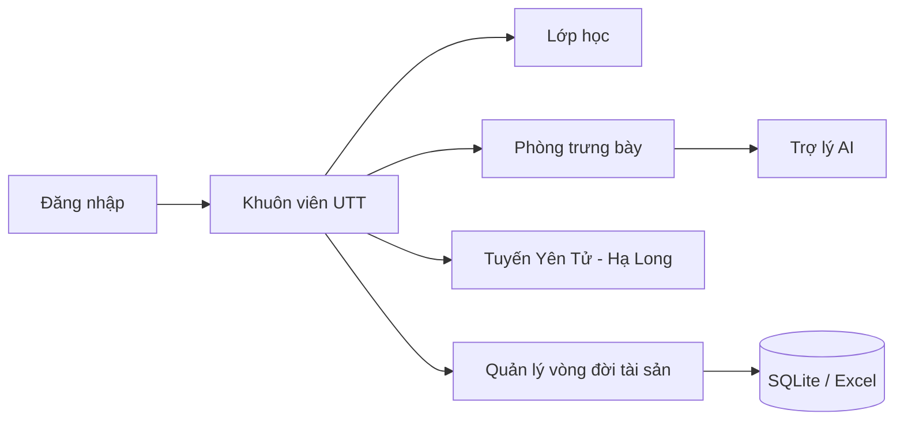

<div align="center">
# RailEduVerse
 
**Nền tảng mô phỏng và đào tạo đường sắt trên thực tế ảo kết hợp BIM**
 
Digital Railway Education and Simulation Platform
 
Trường Đại học Công nghệ Giao thông Vận tải
 
</div>
---
 
## Mục lục
 
1. [Giới thiệu](#gioi-thieu)
2. [Lý do thực hiện và mục tiêu](#muc-tieu)
3. [Video minh họa](#video)
4. [Hình ảnh trình diễn](#hinh-anh)
5. [Các phân hệ chính](#phan-he)
6. [Ứng dụng thực tế](#ung-dung)
7. [Công nghệ sử dụng](#cong-nghe)
8. [Cài đặt và chạy thử](#cai-dat)
9. [Nhóm thực hiện](#nhom-thuc-hien)
---
 
<a id="gioi-thieu"></a>
 
## 1. Giới thiệu
 
RailEduVerse là ứng dụng thực tế ảo do nhóm sinh viên Trường Đại học Công nghệ Giao thông Vận tải phát triển, dùng cho việc dạy học và trình diễn trong lĩnh vực đường sắt. Ứng dụng chạy trực tiếp trên kính Meta Quest 3/3S và có thể dùng trên máy tính.
 
Sau khi đăng nhập, người dùng có thể vào lớp học ảo, xem mô hình đoàn tàu trong phòng trưng bày, ngồi buồng lái chạy tàu trên tuyến Yên Tử – Hạ Long, hoặc mở mô hình BIM của đường ray để xem thông tin từng cấu kiện, từ khâu quy hoạch, thi công cho đến bảo trì và nâng cấp.
 
<a id="muc-tieu"></a>
 
## 2. Lý do thực hiện và mục tiêu
 
Sinh viên ngành đường sắt cần được nhìn tận mắt kết cấu đường ray, đoàn tàu và cách vận hành, nhưng việc đưa sinh viên ra hiện trường tốn kém, khó sắp xếp và không phải lúc nào cũng an toàn. Bên cạnh đó, hồ sơ quản lý tài sản hạ tầng hiện nay phần lớn vẫn nằm trên giấy tờ và bảng tính, rất khó hình dung khi không gắn với mô hình công trình.
 
Nhóm đặt ra bốn mục tiêu:
 
- Xây dựng môi trường học tập 3D gồm nhiều không gian, chạy độc lập trên kính VR mà không cần máy tính đi kèm.
- Mô phỏng tuyến đường sắt và buồng lái để người học làm quen với việc điều khiển tàu.
- Gắn dữ liệu quản lý tài sản vào từng cấu kiện của mô hình BIM, theo đủ sáu giai đoạn trong vòng đời công trình.
- Bổ sung trợ lý AI để người học hỏi đáp bằng văn bản hoặc giọng nói ngay trong ứng dụng.
<a id="video"></a>
 
## 3. Video minh họa
 
<div align="center">
<a href="https://www.youtube.com/watch?v=_0SgPpTBWhc">
  
</a>
 
Xem video tại: https://www.youtube.com/watch?v=_0SgPpTBWhc
 
</div>
<a id="hinh-anh"></a>
 
## 4. Hình ảnh trình diễn
 
Ứng dụng đã được nhóm mang đi trình diễn tại gian trưng bày Công nghệ UAV, BIM, IoT của Nhà trường trong buổi Triển lãm sản phẩm khoa học công nghệ, đổi mới sáng tạo và chuyển đổi số ngành Xây dựng năm 2026. Khách tham quan trải nghiệm trực tiếp bằng kính Meta Quest 3S, hình ảnh trong kính được chiếu lên màn hình lớn.
 
<div align="center">
<table>
  <tr>
    <td align="center" width="50%">
      <br>
      <sub>Hình 1. Khách tham quan chạy thử tàu trên tuyến Yên Tử – Hạ Long</sub>
    </td>
    <td align="center" width="50%">
      <br>
      <sub>Hình 2. Menu chọn không gian hiển thị trong kính</sub>
    </td>
  </tr>
  <tr>
    <td align="center" colspan="2">
      <br>
      <sub>Hình 3. Quan sát mô hình BIM đường ray ở cự ly gần</sub>
    </td>
  </tr>
</table>
</div>
<a id="phan-he"></a>
 
## 5. Các phân hệ chính
 
Ứng dụng có năm không gian. Người dùng mở menu bằng phím F1 trên máy tính hoặc nút Y trên tay cầm trái để chuyển qua lại.
 
| Không gian | Nội dung |
|---|---|
| Khuôn viên UTT | Mô phỏng khuôn viên trường. Người dùng vào đây sau khi đăng nhập với vai trò sinh viên, giảng viên hoặc quản trị viên. |
| Lớp học | Giảng viên chiếu bài giảng lên bảng trong phòng học ảo, chuyển slide thì mọi người trong phòng cùng thấy. Sinh viên làm bài trắc nghiệm ngay trong kính. |
| Phòng trưng bày | Mô hình các đoàn tàu kèm bảng thông số. Sa bàn thu nhỏ tuyến Yên Tử – Hạ Long có tàu chạy, chỉnh được tốc độ từ x1 đến x4 và bật, tắt tám lớp bản đồ. Robot trợ lý đi theo người dùng, nhận câu hỏi bằng bàn phím hoặc micro và đọc câu trả lời thành tiếng. |
| Tuyến Yên Tử – Hạ Long | Lái tàu từ buồng lái, có đồng hồ tốc độ (tối đa 200 km/h), hoặc chuyển sang góc nhìn bên ngoài đoàn tàu. Tuyến được chia thành 58 đoạn và chỉ tải phần quanh vị trí tàu, nhờ vậy kính VR vẫn chạy mượt. |
| Quản lý vòng đời tài sản | Mô hình BIM của hai đường ray được chia thành 34 phân đoạn, 334 mô-đun và 33.066 cấu kiện. Mỗi cấu kiện có hồ sơ riêng cho sáu giai đoạn: quy hoạch, thiết kế, thi công, vận hành, bảo trì và nâng cấp. Người dùng có thể ghi kết quả kiểm tra, công việc bảo trì và chi phí. Dữ liệu được lưu bằng SQLite và có thể nhập từ hoặc xuất ra file Excel. |
 
Một số điểm khác:
 
- Toàn bộ giao diện bằng tiếng Việt. Trong kính có bàn phím ảo gõ được đầy đủ dấu tiếng Việt.
- Mỗi cấu kiện có mã định danh cố định (ví dụ `Z021-TR-S001-B001-C005`), nên dữ liệu nhập từ Excel luôn khớp đúng đối tượng. Trước khi ghi vào cơ sở dữ liệu, file Excel được kiểm tra mã, kiểu dữ liệu và ngày tháng; nếu có lỗi thì toàn bộ lần nhập được hủy.
- Ứng dụng đã tích hợp Photon Fusion để mở rộng sang lớp học nhiều người dùng. Bản trình diễn hiện tại chạy ở chế độ offline.
<a id="ung-dung"></a>
 
## 6. Ứng dụng thực tế
 
Theo nhóm, ứng dụng có thể đưa vào sử dụng trong các trường hợp sau:
 
1. **Giảng dạy chuyên ngành đường sắt.** Giảng viên dùng mô hình 3D để giải thích cấu tạo đường ray và đoàn tàu; sinh viên có thể tự quan sát, xoay, phóng to từng chi tiết thay vì chỉ xem bản vẽ.
2. **Làm quen với việc vận hành tàu.** Người học thử điều khiển tàu trên tuyến mô phỏng trước khi tiếp xúc với thiết bị thật, không có rủi ro về an toàn.
3. **Quản lý tài sản hạ tầng.** Đơn vị quản lý có thể tra cứu lịch sử kiểm tra, bảo trì và chi phí của từng cấu kiện ngay trên mô hình, thay cho việc dò tìm trong hồ sơ giấy.
4. **Giới thiệu dự án đường sắt.** Mô hình tuyến và sa bàn có thể dùng để trình bày phương án tuyến với cơ quan quản lý, đối tác và người dân.
<a id="cong-nghe"></a>
 
## 7. Công nghệ sử dụng
 

 
| Hạng mục | Công nghệ |
|---|---|
| Phát triển ứng dụng | Unity 6 (6000.3.0f1), Universal Render Pipeline |
| Thực tế ảo | OpenXR, Meta OpenXR, XR Interaction Toolkit 3.7 |
| Kết nối nhiều người dùng | Photon Fusion |
| Dữ liệu BIM | SQLite (sqlite-net), ExcelDataReader |
| Xử lý mô hình 3D | Pixyz, FBX, Unity Splines, ProBuilder |
| Trợ lý AI | Mô hình ngôn ngữ lớn gọi qua Cloudflare Worker, nhận dạng và tổng hợp giọng nói |
| Máy chủ quản lý lớp học | Python Flask, SQLite |
 
<a id="cai-dat"></a>
 
## 8. Cài đặt và chạy thử
 
Cần có Unity 6000.3.0f1 và Git LFS. Kính Meta Quest 3/3S chỉ cần khi muốn chạy trên thiết bị.
 
```bash
git lfs install
git clone https://github.com/hptip/RailEduVerse-Digital-Railway-Education-Simulation-Platform.git
cd RailEduVerse-Digital-Railway-Education-Simulation-Platform
git lfs pull
```
 
1. Mở thư mục dự án bằng Unity Hub, chọn phiên bản 6000.3.0f1.
2. Mở scene `Assets/ProjectLopHoc/Scenes/Login.unity` rồi nhấn Play.
3. Để cài lên kính: vào File > Build Profiles, chọn Android, cắm kính Meta Quest qua cáp USB rồi chọn Build And Run.
**Điều khiển**
 
| Thao tác | Máy tính | Kính Meta Quest |
|---|---|---|
| Mở menu chọn không gian | F1 | Nút Y (tay trái) |
| Chọn đối tượng, bấm nút | Chuột trái | Nút trigger |
| Xoay và thu phóng góc nhìn | Giữ chuột phải và kéo, cuộn chuột | Quay đầu |
| Bay tự do khi ẩn giao diện | W, A, S, D, Q, E (giữ Shift để đi nhanh) | Cần điều hướng |
| Ẩn hoặc hiện giao diện | F2 | Nút X (tay trái) |
 
**Cấu trúc thư mục**
 
```
Assets/
├── ProjectLopHoc/        Mã nguồn chính
│   ├── Scenes/           Login, UTTCampus, Classroom, Showroom, YenTuHaLongXanh, QuanLyVongDoiTaiSan
│   ├── Features/         Đăng nhập, bài giảng, trắc nghiệm
│   └── Scripts/          Chạy tàu, tải tuyến theo đoạn, XR, quản lý vòng đời tài sản
├── ChiTietSaBan/         Xem chi tiết cấu kiện đường ray
├── ShowroomIntegration/  Sa bàn trong phòng trưng bày
└── Editor/               Công cụ hỗ trợ dựng scene, kiểm thử và build cho Meta Quest
Backend/                  Máy chủ quản lý tài khoản và điểm (Flask)
Documentation/            Tài liệu kỹ thuật của từng phân hệ
```
 
<a id="nhom-thuc-hien"></a>
 
## 9. Nhóm thực hiện
 
**Giảng viên hướng dẫn:** TS. Nguyễn Duy Cương
 
| STT | Họ và tên |
|:---:|---|
| 1 | Phan Anh Hào |
| 2 | Nguyễn Duy Anh |
| 3 | Đinh Cao Hùng |
| 4 | Bùi Đoàn Tiến Dũng |
 
