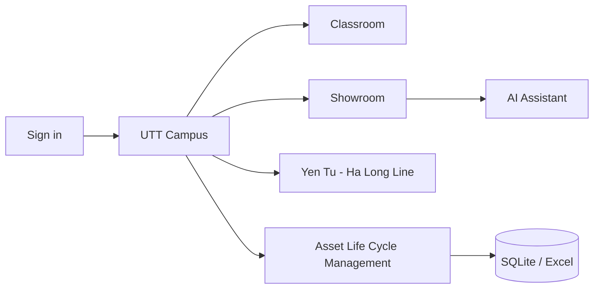

<div align="center">
# RailEduVerse
 
**A Virtual Reality and BIM Platform for Railway Education and Simulation**
 
University of Transport Technology (UTT), Hanoi, Vietnam
 
</div>
---
 
## Table of Contents
 
1. [Introduction](#introduction)
2. [Motivation and Objectives](#objectives)
3. [Demo Video](#video)
4. [Exhibition Photos](#photos)
5. [Main Modules](#modules)
6. [Real-World Applications](#applications)
7. [Technology](#technology)
8. [Installation](#installation)
9. [Team](#team)
---
 
<a id="introduction"></a>
 
## 1. Introduction
 
RailEduVerse is a virtual reality application developed by a student team at the University of Transport Technology (UTT) for teaching and demonstration in the railway field. It runs standalone on Meta Quest 3/3S headsets and can also be used on a PC.
 
After signing in, users can attend a virtual classroom, look at train models in a showroom, drive a train from the cab along the Yen Tu – Ha Long line, or open the BIM model of the track to inspect each component and its records, from planning and construction through to maintenance and upgrades.
 
<a id="objectives"></a>
 
## 2. Motivation and Objectives
 
Railway engineering students need to see track structures, rolling stock and train operation for themselves, but site visits are expensive, hard to schedule and not always safe. At the same time, infrastructure asset records are still kept mostly on paper and in spreadsheets, which makes them difficult to interpret without a link to the physical structure.
 
The team set four objectives:
 
- Build a multi-space 3D learning environment that runs standalone on a VR headset, with no PC required.
- Simulate a railway line and a driver's cab so that learners can practise controlling a train.
- Attach asset management data to every component of the BIM model, covering all six stages of the asset life cycle.
- Add an AI assistant that learners can question by text or voice inside the application.
<a id="video"></a>
 
## 3. Demo Video
 
<div align="center">
<a href="https://www.youtube.com/watch?v=_0SgPpTBWhc">
  
</a>
 
Watch on YouTube: https://www.youtube.com/watch?v=_0SgPpTBWhc
 
</div>
<a id="photos"></a>
 
## 4. Exhibition Photos
 
The team presented the application at the UAV, BIM and IoT Technology booth of the University during the [2026 Exhibition of Science and Technology, Innovation and Digital Transformation Products in the Construction Sector](https://www.utt.edu.vn/vn/utt/tin-tuc/utt-tham-gia-trien-lam-san-pham-khoa-hoc-cong-nghe-doi-moi-sang-tao-va-chuyen-doi-so-nganh-xay-dung-nam-2026-a17467.html). Visitors tried it on a Meta Quest 3S headset while the headset view was mirrored to a large screen.
 
<div align="center">
<table>
  <tr>
    <td align="center" width="50%">
      <br>
      <sub>Figure 1. A visitor driving the train on the Yen Tu – Ha Long line</sub>
    </td>
    <td align="center" width="50%">
      <br>
      <sub>Figure 2. The space selection menu inside the headset</sub>
    </td>
  </tr>
  <tr>
    <td align="center" colspan="2">
      <br>
      <sub>Figure 3. Close-up inspection of the BIM track model</sub>
    </td>
  </tr>
</table>
</div>
<a id="modules"></a>
 
## 5. Main Modules
 
The application has five spaces. Users switch between them from a shared menu, opened with F1 on a PC or the Y button on the left controller.
 
| Space | Description |
|---|---|
| UTT Campus | A model of the university campus. Users arrive here after signing in as a student, lecturer or administrator. |
| Classroom | The lecturer presents slides on a board in the virtual classroom, and everyone in the room sees each slide change. Students take quizzes directly in the headset. |
| Showroom | Train models with specification panels. A miniature model of the Yen Tu – Ha Long line has a running train, speed control from x1 to x4 and eight map layers that can be switched on and off. A robot assistant follows the user, takes questions from the keyboard or microphone and reads its answers aloud. |
| Yen Tu – Ha Long Line | Drive the train from the cab with a speedometer (up to 200 km/h), or switch to an external view of the train. The line is divided into 58 sections and only the sections around the train are loaded, which keeps the frame rate smooth on the headset. |
| Asset Life Cycle Management | The BIM model of the two tracks is organised into 34 segments, 334 modules and 33,066 components. Each component has its own record for six stages: planning, design, construction, operation, maintenance and upgrade. Users can log inspection results, maintenance work and costs. Data is stored in SQLite and can be imported from or exported to Excel. |
 
Other notes:
 
- The interface is fully localised in Vietnamese, including an on-screen keyboard in the headset that supports Vietnamese diacritics.
- Every component has a fixed identifier (for example `Z021-TR-S001-B001-C005`), so data imported from Excel always matches the right object. Before anything is written to the database, the Excel file is checked for valid IDs, data types and dates; if any error is found, the whole import is rolled back.
- Photon Fusion is already integrated so the classroom can be extended to multiple users. The current demo build runs in offline mode.
<a id="applications"></a>
 
## 6. Real-World Applications
 
The team sees the following uses for the application:
 
1. **Teaching railway engineering.** Lecturers use the 3D models to explain how track and rolling stock are built, and students can examine, rotate and zoom in on each part themselves instead of relying only on drawings.
2. **Introductory train operation training.** Learners practise driving on a simulated line before working with real equipment, without any safety risk.
3. **Infrastructure asset management.** Operators can look up the inspection, maintenance and cost history of each component directly on the model, rather than searching through paper files.
4. **Presenting railway projects.** The line model and the miniature layout can be used to present route options to authorities, partners and local communities.
<a id="technology"></a>
 
## 7. Technology
 

 
| Area | Technology |
|---|---|
| Application development | Unity 6 (6000.3.0f1), Universal Render Pipeline |
| Virtual reality | OpenXR, Meta OpenXR, XR Interaction Toolkit 3.7 |
| Multiplayer | Photon Fusion |
| BIM data | SQLite (sqlite-net), ExcelDataReader |
| 3D model processing | Pixyz, FBX, Unity Splines, ProBuilder |
| AI assistant | Large language model via Cloudflare Worker, speech recognition and text-to-speech |
| Classroom management server | Python Flask, SQLite |
 
<a id="installation"></a>
 
## 8. Installation

[Hướng dẫn nhanh bằng tiếng Việt để build Web và tự kiểm thử trên Windows](Documentation/PlatformCompatibility/WebTests/QUICKSTART_WINDOWS.md)
 
Requirements: Unity 6000.3.0f1 and Git LFS. A Meta Quest 3/3S headset is only needed to run the app on the device.
 
```bash
git lfs install
git clone https://github.com/hptip/RailEduVerse-Digital-Railway-Education-Simulation-Platform.git
cd RailEduVerse-Digital-Railway-Education-Simulation-Platform
git lfs pull
```
 
1. Open the project folder in Unity Hub with version 6000.3.0f1.
2. Open the scene `Assets/ProjectLopHoc/Scenes/Login.unity` and press Play.
3. To install on the headset, go to File > Build Profiles, select Android, connect the Meta Quest by USB and choose Build And Run.
**Controls**
 
| Action | PC | Meta Quest |
|---|---|---|
| Open the space selection menu | F1 | Y button (left controller) |
| Select objects, press buttons | Left mouse button | Trigger |
| Rotate and zoom the view | Right mouse drag, scroll wheel | Turn your head |
| Free flight with the UI hidden | W, A, S, D, Q, E (hold Shift to move faster) | Thumbstick |
| Show or hide the UI | F2 | X button (left controller) |
 
**Folder structure**
 
```
Assets/
├── ProjectLopHoc/        Main source code
│   ├── Scenes/           Login, UTTCampus, Classroom, Showroom, YenTuHaLongXanh, QuanLyVongDoiTaiSan
│   ├── Features/         Sign-in, lectures, quizzes
│   └── Scripts/          Train control, section streaming, XR, asset life cycle management
├── ChiTietSaBan/         Detailed view of track components
├── ShowroomIntegration/  Miniature line model in the showroom
└── Editor/               Scene building, testing and Meta Quest build tools
Backend/                  Account and score server (Flask)
Documentation/            Technical documentation for each module
```
 
<a id="team"></a>
 
## 9. Team
 
**Supervisor:** Dr. Nguyễn Duy Cương
 
| No. | Full name |
|:---:|---|
| 1 | Phan Anh Hào |
| 2 | Nguyễn Duy Anh |
| 3 | Đinh Cao Hùng |
| 4 | Bùi Đoàn Tiến Dũng |
 
